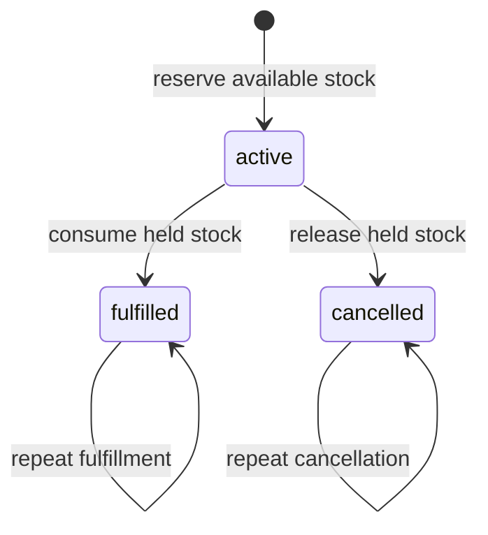

# Inventory correctness and tradeoffs

## The data model

| Table | Responsibility | Important database protections |
| --- | --- | --- |
| `products` | SKU, name, physical `on_hand`, `reserved` counter | Unique normalized SKU; `0 <= reserved <= on_hand <= 1,000,000` |
| `reservations` | Immutable product/quantity, state, retry key | Product foreign key; positive quantity; allowed states; unique reservation retry key |
| `stock_movements` | Opening balances, adjustments and fulfillments | Product/reservation foreign keys; nonzero delta; allowed operation shape; unique adjustment key and fulfillment reservation |

`available = on_hand - reserved`. A reservation is not a physical movement. Cancellation therefore creates no ledger entry; fulfillment creates one negative entry. Ledger IDs are database-generated sequence numbers, and ledger pages are ordered by ID. Sequence gaps after a rollback are normal.

Two cross-table invariants are maintained by the application transactions:

1. `products.reserved` equals the sum of that product's **active** reservation quantities.
2. `products.on_hand` equals the sum of its movement deltas.

The integration fixture recalculates these using independent SQL after each integration test. Database check constraints protect individual rows, foreign keys protect references, and unique constraints protect operation identities. Direct SQL can still create inconsistent cross-table totals if it bypasses the transaction protocol; there is no trigger-based accounting system here.

## Serialize writers for one product

Each write uses a fresh SQLAlchemy session and a single explicit transaction:

1. Lock the product row with `SELECT ... FOR UPDATE`.
2. Check for an earlier successful operation with the retry key.
3. Validate the current stock/state while holding the lock.
4. Change the stock counter and insert/update the reservation or ledger row.
5. Commit before returning a successful HTTP response; errors roll back every change.

At PostgreSQL's default **READ COMMITTED** isolation, a competing writer waits for the product row, then reads its updated state. It cannot decide availability from an earlier unlocked value. Operations on distinct products can proceed independently. Transitions first read the reservation's immutable product ID, then lock **product → reservation**, using that order for both fulfillment and cancellation.

Trying the opposite terminal transition returns `409 reservation_closed`. Repeating the already-completed action returns `200` without another stock change. Creating a reservation again with its original key returns the resource's **current** state, which may already be terminal.

## Retry keys and the cross-product race

Reservation creation and stock adjustment creation require a UUID `Idempotency-Key`. A replay with the same normalized payload returns `200` and `Idempotent-Replayed: true`; the first success returns `201`. A different payload using that key returns `409 idempotency_conflict`. Failed operations do not retain keys. Keys are retained as long as the demonstration data are retained, with separate namespaces for reservations and adjustments.

A product row lock serializes repeated keys on the same product. It cannot serialize a key used concurrently against **different** products. In that case, the database's unique index chooses the winner. The losing insert raises an integrity error; exiting `session.begin()` rolls back its earlier stock change before the service returns `409`. The concurrency test deliberately keeps a winning operation uncommitted, observes the competing PostgreSQL lock wait, commits the winner, and verifies the loser left no stock change.

Lock waits and statements have bounded timeouts. A lock timeout, deadlock victim or statement cancellation returns a sanitized `503 database_busy` with `Retry-After: 1`. Clients should retry the same payload/key for reservation or adjustment creation. Other database failures return `503 database_unavailable`; database URLs, SQL parameters and credentials are not returned in the error body.

Product creation uses SKU uniqueness rather than an operation-key API: a duplicate returns `409 duplicate_sku`. No automatic application retry is performed. That keeps contention and error handling inspectable; the project does not promise exactly-once delivery across networks.

## Deliberate scope

- One product per reservation avoids multi-product lock ordering and partial order fulfillment.
- A cached `reserved` counter makes the availability check constant in reservation count, at the cost of maintaining the counter and rows together.
- A single shared operator API key gives the local API an explicit access boundary, but is not a production user/role model.
- Alembic owns schema changes; application startup never calls `create_all`. Readiness requires the expected migration revision.
- Bounded limit/offset pagination is simple for this small dataset. There is no promise of a stable snapshot across separate page requests.
- The test suite exercises concrete races against PostgreSQL. It is not a formal proof, a throughput benchmark or validation of production operations.

## Primary references

- [PostgreSQL 17: explicit and row-level locking](https://www.postgresql.org/docs/17/explicit-locking.html)
- [SQLAlchemy 2.0: framing a begin / commit / rollback transaction](https://docs.sqlalchemy.org/en/20/orm/session_basics.html#framing-out-a-begin-commit-rollback-block)

The implementation and tests are the project's evidence; the references explain the database and session behavior on which it relies.
